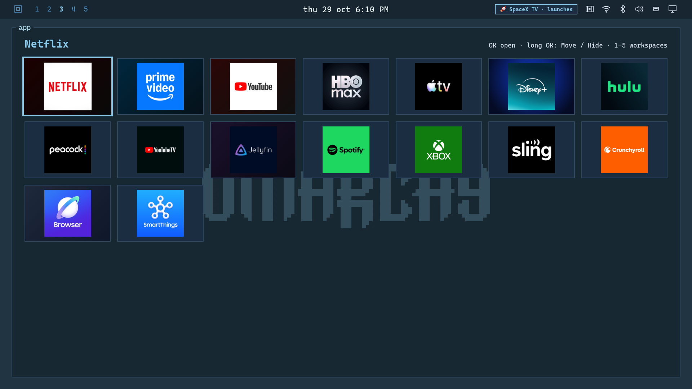

# Install OmarchyTV on Samsung Tizen

The Samsung widget shares its interface with `webos/app/`. It discovers installed
consumer apps, displays their artwork, and selects native TV and HDMI sources.
App order and hidden-app settings survive catalogue refreshes.

Validated on Samsung UN55U7900FFXZA, Tizen 9, firmware
`T-X22UDFAKUC-0090-1300.8`. Other models and firmware versions need hardware testing.


The install procedure below uses the standard Tizen Studio tools. Local hardware
validation used an existing Samsung certificate and developer connection.

## Build an unsigned widget

Run from the repository root with Python 3 installed:

```bash
python3 tizen/build-wgt.py tizen/out/my-build
```

The Bash entry point uses the same builder:

```bash
./tizen/build-wgt.sh tizen/out/my-other-build
```

Each build produces `OmarchyTV-tizen-<version>-unsigned.wgt` and its SHA-256.
The version comes from `tizen/config.xml`. The builder includes the shared fonts,
wallpapers, screensaver, license files, and bundled icons from the repository.
It does not require generated webOS assets or a previous Android build.
Existing widgets are preserved. Use a new output directory for another build.

## Sign with an existing Samsung certificate profile

Samsung TVs require a signed widget. Install Tizen Studio with the TV Extensions
and Samsung Certificate Extension. Configure a Samsung certificate profile for
your TV in Certificate Manager. Keep certificate files and passwords outside
this repository. When updating an installed widget, retain its author certificate.

With the Tizen Studio `tizen` CLI on your `PATH`, run:

```bash
TIZEN_PROFILE=my-profile ./tizen/build-wgt.sh tizen/out/my-signed-build
```

The wrapper writes a complete `stage/` directory and asks the Tizen CLI to package
it into `signed/`. Use the signed filename reported by that CLI. Setting
`TIZEN_PROFILE` without a `tizen` executable is an error, rather than an unsigned
fallback. You can also import the unsigned widget into Tizen Studio to sign it.

See Samsung's [command-line guide](https://developer.samsung.com/smarttv/develop/getting-started/using-sdk/command-line-interface.html)
for certificate profiles and packaging commands.

## Connect and install

Enable Developer Mode only if it is not already configured:

1. Open **Apps** on the TV and enter `1 2 3 4 5` on the remote.
2. Enable Developer Mode and enter your computer's LAN IP.
3. Follow the TV's restart instruction.

Connect the computer and TV to the same network. Replace the placeholders in
these commands with your TV IP, target name, signed filename, and output directory:

```bash
sdb connect <TV_IP>
sdb devices
tizen install -n <SIGNED_WIDGET_FILENAME> -t <DEVICE_NAME> -- <SIGNED_WIDGET_DIRECTORY>
tizen run -p OmarchyTV0.OmarchyTV -t <DEVICE_NAME>
```

The application ID is `OmarchyTV0.OmarchyTV`. Its package ID is `OmarchyTV0`.
These instructions install an ordinary app. Assigning Samsung's Home button or
granting protected shortcut-key access is a separate operation outside this
widget's build and install process.

## Use apps and inputs

The Home dock and Apps workspace use the installed consumer-app catalogue.
Discovery refreshes when the launcher becomes visible. The catalogue filter
excludes internal Samsung services; it may need additions for other models or regions.

Known apps first try the TV's local store artwork, then their native icon path.
Other apps use their native icon path. If no image loads, a generic app icon and
the app name remain visible. No artwork service or account is required.

The Inputs workspace and Cinemarchy's Live TV tab list the TV's actual sources.
Selecting TV or HDMI refreshes the source catalogue, changes the source, confirms
its type and number, then opens Samsung's native viewer. The TV row selects the
tuner source instead of reopening the last HDMI input. Connected labels describe
the source catalogue, not a guarantee that an attached device is powered on.

## Text size (new in `2.13.2-testing`)

**Bigger text on LG webOS and Samsung Tizen:** launcher text can now be enlarged from **Settings > System > Text size**: Small 90%, Normal 100% (default), Large 115% and Extra large 130%. It applies to the whole launcher, it is saved across restarts, and it is translated in English, Italian and German. The Samsung widget uses the same shared app, so the option is identical to webOS.

## Remote keys and optional integrations

Arrows and OK navigate and open items. Return goes back. Number, colour, channel,
and media keys are registered through `tizen.tvinputdevice`. Home and branded
app shortcut keys remain reserved by Samsung in an ordinary widget installation.

If the compatible `OmKeyCtrl0.Keys` helper is already installed independently,
OmarchyTV starts it when needed and leaves an existing instance running. A fresh
widget installation works without that helper. The widget build does not provide its
native package, protected-policy grant, Home routing, or privileged setup tools.

The PC dashboard uses the same LAN status bridge as the webOS build. See
[Connecting Your Omarchy Linux PC](../webos/INSTALL-WEBOS.md) for its capabilities
and configuration. Android-specific PC mirroring and command features are not
part of the Samsung widget integration.

## Verify a change

Run the shared UI and Samsung adapter checks from the repository root:

```bash
node --test tizen/*.test.cjs webos/tests/*.test.js
python3 tizen/verify-build.py
```

Then test on a real TV. Check D-pad navigation at each grid edge, launch an app,
select every available input, switch from HDMI back to TV, and return to the
launcher. Check installed artwork and a missing-image fallback. Include the
model, firmware, observed limitations, and a screenshot with your contribution.

The widget requests public privileges for networking, app discovery and launch,
remote input, and TV source control. It does not change TV security policy or
Home routing as part of installation.
